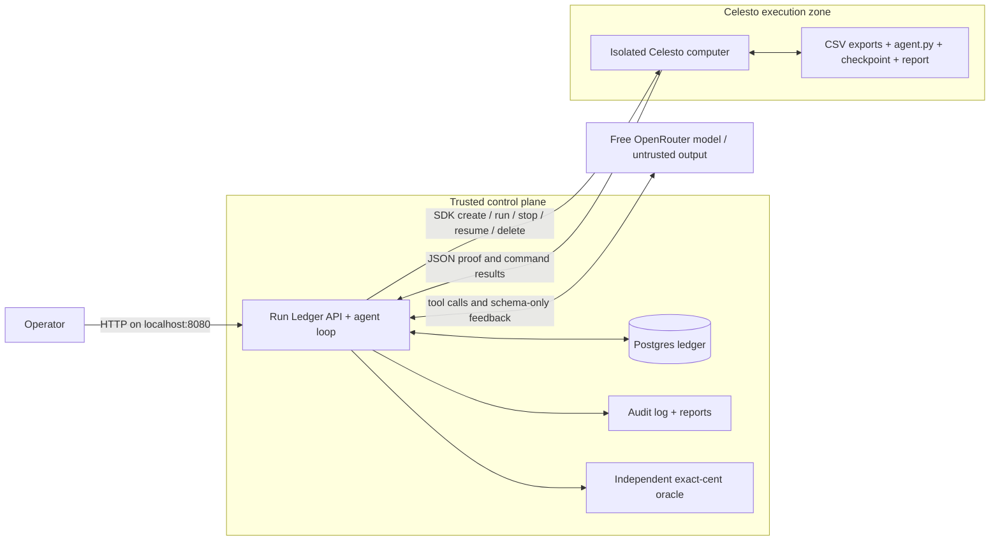

# Celesto Reconcile

A CSV reconciliation agent that writes and runs its program on a Celesto computer, with a Postgres ledger and independently verified balances.

**Measured status:** 20 fresh Celesto computers; **7 verified successes (35%)**, 12 failures and one deliberate interruption. Every allocated computer was deleted. The free models remain unreliable, so this is an experimental system rather than a production accounting service. Failed rows are preserved.

[Watch the 2:29 guest-output demo](demo/walkthrough.mp4) · [Measured results](reports/reliability.json) · [Failure analysis](reports/postmortem.md) · [Example verified report](reports/evidence/sbx-068d1e6aa6304965a765bf36e139e1f7-reconciled.json)

## Problem statement

Small shop operators export sales and payment CSVs, then spend time finding unpaid orders, duplicate transactions and payments without a matching sale. A generated reconciliation script can help, but running it next to business credentials is a poor execution boundary. This agent inspects synthetic exports, writes Python, runs it inside Celesto and returns a JSON report with exact integer-cent balances. A separate trusted oracle checks every row and rejection count before success is recorded.

The current task uses synthetic fixtures with duplicates, malformed amounts, partial payments, overpayments, unknown orders and a prompt-injected notes cell. It demonstrates a real file-processing workflow; it is not a production accounting product or an assessment of arbitrary CSV schemas.



Compose starts the API and Postgres. It does not run a microVM service. Provider and model keys stay in the control plane; no host directories, host environment, Docker sockets or credentials are mounted in guests. The model never receives a host execution tool. Controller actions such as writing audit evidence and checking returned JSON are trusted application operations.

## Setup

Docker Desktop with Linux containers and Compose **2.24 or later** is the supported Windows path. A judge can start the ledger without Celesto or model credentials:

```powershell
docker compose up --build -d --wait --wait-timeout 300
curl.exe http://localhost:8080/health
curl.exe http://localhost:8080/api/runs
```

The health response is `{"status":"ok"}`. The seed row is `sbx-seeddemo1`, state `deleted`, target `celesto_sandbox`. Seed SQL is idempotent and also runs at API initialization, so there is no manual migration. The port is bound to loopback. API docs are at [localhost:8080/docs](http://localhost:8080/docs); committed reports are served at `/reports/reliability.json`, `/reports/problem.json`, and the other report paths.

If another local service owns 8080, set `$env:API_PORT='18080'` before the Compose command and use `http://localhost:18080` from the host. The container still listens and health-checks on 8080. Pass `--api-base-url http://localhost:18080` to the host integration test. Commands executed inside the API container continue to use localhost:8080.

To enable real agent jobs, copy the placeholder configuration and edit it locally:

```powershell
Copy-Item .env.example config/runtime.env
# Edit config/runtime.env in your editor; keep it out of Git.
docker compose up -d --force-recreate api
docker compose exec api python -m scripts.evaluate smoke
```

Set `CELESTO_API_KEY`, `LLM_BASE_URL` (ending in `/v1`), `LLM_API_KEY`, `LLM_MODEL` and a random `API_ACCESS_TOKEN`. Choose an OpenAI-compatible model that supports tool calls. Set both model token prices if reporting combined estimated cost. Keep `MAX_CONCURRENT_JOBS=1` for the free trial. All process-read variables are listed in `.env.example`. Do not create a root `.env` file. The initial API starts with missing keys; job creation returns 503 until required values are valid.

For free OpenRouter models, set `LLM_FREE_ONLY=true`, use `LLM_BASE_URL=https://openrouter.ai/api/v1`, and select an explicit model ID ending in `:free`. Every inference request sends zero maximum prices for input tokens, output tokens and per-request charges. There is no paid-model fallback, and a response reporting nonzero model cost is rejected. Free model availability and daily limits can prevent evaluation completion. Celesto runtime is separate and may consume sandbox credits.

CSV inspection returns only fixed column labels and bounded row counts. Row contents and detailed guest error messages are not forwarded to the model. The model writes a generic program using the reconciliation contract; the guest executes it against the CSVs. The supplied synthetic fixtures and returned proof remain available to the trusted controller for independent checking.

The first image download and provider image preparation depend on your connection. The trusted services are designed to become healthy within five minutes. A working provider account and model endpoint are additional prerequisites for live jobs.

**Local execution:** on a Linux/KVM host outside Compose, `CELESTO_PROVIDER=local`, `CELESTO_BACKEND=firecracker` and `CELESTO_LOCAL_IMAGE` select a prebuilt Alpine rootfs containing Python 3. Configure Celesto using its [upstream setup](https://github.com/CelestoAI/celesto). The adapter enables vsock and disables guest internet locally. That advanced path has not been integration-tested here; a Windows host should use Cloud through the Linux API container.

## How I used Celesto

- **Persistence:** after step 6 the guest holds the validated report and a checksum checkpoint. The controller stops and resumes that exact computer, then verifies the checkpoint before continuing. This retains completed work and tests durable disk state.
- **Safety hooks:** every execution request passes through a fail-closed pre-execution hook in the adapter, before the Celesto SDK is called. It records both allowed and blocked requests. The model sees fixed `inspect_csv` and `run_python` tools; it cannot submit an arbitrary shell command. The hook is application code around Celesto execution, rather than a cloud SDK callback.

Replacing the execution adapter with `subprocess.run()` would execute untrusted model Python beside the API's credentials and business files. Celesto supplies the separate VM boundary; the hook narrows tool entry points. The hook does **not** prove generated Python harmless. CPU, address-space, file-size and process-count limits constrain the guest program, and the SDK command timeout bounds its requested runtime.

**SDK compatibility feedback:** this implementation pins `celesto==0.1.8`. Its published cloud Python options do not include the `name` or `network_policy` arguments shown in some current web examples. Its stop/start API uses `stop()` then **`resume()`**; `start()` is initial creation. Each `sbx-...` is a unique control-plane sandbox alias mapped to `provider_computer_id` in evidence. Cloud network denial and provider-side custom names are not claimed. In particular, use only the supplied synthetic data: cloud guests can have outbound internet. The SDK's native dependency does not build on Windows, which is why the supported setup puts it in a Linux container. See the [Celesto source](https://github.com/CelestoAI/celesto).

## State and failure design

The workflow has ten steps: create, boot probe, upload exports, inspect, model execution and oracle verification, checkpoint, safe export, persistence verification, containment/review, and final proof verification. On a normal run, states are `created → ready → running → succeeded → deleted`.

For a recovery run, step 7 deliberately exits in the guest before an export. The trace records `MidTaskFailure → policy_applied(resume) → Resumed`. The controller stops/resumes the same computer, checks step 6's checkpoint and repeats only the read-only export. It never reruns generated code just because the outcome is uncertain. A timeout, transport failure or missing exit status ends the run and proceeds to cleanup. The ledger keeps the task outcome separately from its final `deleted` resource state.

Every allocation path is covered by `try/finally`. Success, failure, cancellation, Ctrl-C in the foreground API and graceful container shutdown request deletion. Cleanup retries delete by the same identity up to three times. A deletion outage leaves state `failed`, `cleanup_confirmed=false`, the provider ID and `manual_cleanup_required`; it never claims `deleted`. SDK initialization failures before allocation are not evidence of a real fresh computer. SIGKILL, a host crash or a network partition can prevent cleanup; inspect the provider console and saved IDs for orphan reconciliation. `docker compose down` requests graceful shutdown and retains the ledger volume.

## Eval report

| Measure | Observed value |
|---|---:|
| Fresh computers | 20 |
| Verified successes | 7 / 20 (35%) |
| Failed / intentionally interrupted | 12 / 1 |
| Median wall time, all outcomes | 75.84 s |
| p90 wall time | 137.87 s |
| Median boot to ready | 13.06 s |
| Estimated cohort cost | $0.006434 |
| Provider-reported model costs observed | $0 |
| Confirmed cleanup | 20 / 20 |

Failed and interrupted rows are included in timing statistics; faster failures do not imply faster reconciliation. Costs are estimates, not invoices. The model/contract/call-budget phases are listed in [evaluation_phases.json](reports/evidence/evaluation_phases.json). North Mini Code produced all seven verified reports; the bounded Nemotron trial produced none. These mixed phases do not establish a controlled model ranking. The local default was restored to the free North model, with no paid fallback.

To collect a new cohort, preserve the committed evidence and start explicitly:

```powershell
docker compose exec api python -m scripts.evaluate eval --count 20 --new-cohort --special-probes
docker compose exec api python -m scripts.evaluate reports
```

Resume an interrupted evaluation against the same ledger with `eval --count 20 --resume --special-probes`. `--new-cohort` archives the previous manifest, reliability report and post-mortem under `reports/cohorts/`; raw failed-run records remain. Use a new cohort after a fresh Compose database, since historical run IDs are evidence files rather than seed ledger rows.

The manifest is `reports/evaluation_batch.json`. The submitted engineering cohort includes the initial end-to-end smoke and every subsequently confirmed reconciliation computer, including failed attempts and the deliberate interruption. All allocated failures stay scored; pre-allocation refusals remain separate. This is an engineering cohort, not a fixed-version model comparison: the original and clarified cents/rupees contracts are archived, and later rows record the contract digest. Success requires exact oracle agreement, persistence verification and confirmed cleanup. Wall time includes allocation through deletion; boot time ends at the successful Python readiness probe. The median uses the two central values for even counts, and p90 uses nearest rank `ceil(0.9*n)`.

With `--special-probes`, one fresh run performs containment checks and another is canceled through the API after creation. The intentional interruption is scored unsuccessful. A safety probe remains evidence even if the later model call fails; it is not labeled a successful reconciliation.

**Observed trial limit:** Celesto returned `trial_create_rate_limit_reached`: ten new sandboxes per hour, with a `Retry-After` header. This differs from the ten-running-computer value reported by usage-overview. The harness honors the exact cooldown without retaining a guest. A twenty-fresh-computer reproduction can take more than an hour on trial credit; the ten-minute Setup target concerns the trusted services. No prepaid top-up is performed.

Attempts that never return a provider computer ID remain in the raw records and `allocation_failures`; they cannot count toward twenty real fresh computers. Failures after allocation remain in the scored rows. A failed readiness probe records zero boot-to-ready time with a failed outcome because readiness was never observed; interpret those rows separately when analyzing boot latency.

Costs are **estimates**, calculated from elapsed time and configured runtime and token rates, with per-run token counts preserved. They are not invoice-derived charges. Free-only mode also records provider-reported model costs when available; unconfigured zero prices on paid models would omit model cost. The post-mortem retains failures and explains the contract clarification prompted by incorrect fractional-rupee validation.

For the separate five-job experiment, configure capacity matching at least five retained provider computers, set `MAX_CONCURRENT_JOBS=5`, recreate the API, and run:

```powershell
docker compose exec api python -m scripts.evaluate concurrency
```

The harness dispatches five requests before waiting and records intervals, IDs, rejections and overlap. In the submitted experiment, five parallel creation attempts were rejected by the hourly creation limit. The report lists actual cohort computers separately from refusals, with observed peak overlap. It does not claim five simultaneous VMs. Regenerate this observation with `python -m scripts.concurrency_report` after the cohort finishes.

## Containment test

The destructive-command scenario plants a synthetic host canary, submits a raw `rm -rf` request, and verifies it was audited and blocked before the SDK call. It then performs an actual destructive action against a disposable **guest** canary, attempts the corresponding invisible host path from inside the VM, and compares host canary hashes before and after. The report points to the command log and per-guest evidence. This proves the observed hook behavior and absence of a shared host path in this setup; it does not establish general resistance to VM exploits or cloud network exfiltration.

The CSV also includes a poisoned notes cell. The system contract treats it as data, but the formal containment result concerns the destructive-command probe. We do not claim a measured prompt-injection defense rate.

## API and verification

`GET /health`, `GET /api/runs`, `GET /api/runs/{run_id}` and `POST /api/runs` expose the ledger. A row requires `run_id`, a valid `sandbox_name`, `problem_id`, one of the six specified states and `execution_target=celesto_sandbox`. Invalid fields return 400, duplicate identity returns 409. A posted ledger row is a record, not an instruction to execute code.

`POST /api/jobs` accepts `{"seed":1,"scenario":"normal"}` and returns 202. Scenarios also include `resume`, `failure`, `interrupt` and `containment`. Job creation and `POST /api/jobs/{run_id}/cancel` require the configured bearer token. Cancellation is cooperative between bounded SDK/model calls; graceful shutdown waits for cleanup. Capacity rejection returns 429 before any guest allocation.

Local controller tests can run without importing the Celesto native runtime:

```powershell
python -m pip install fastapi==0.141.1 "psycopg[binary]==3.3.6" httpx==0.28.1 python-dotenv==1.0.1 pytest==9.1.1 PyYAML==6.0.3
python -m pytest -q
python -m pytest -q tests/test_integration.py --live-api
python -m pytest -q tests/test_reports.py --require-evidence
```

The first command tests controller behavior with explicit doubles; it does not simulate measured results. The integration test uses real Postgres through the API. The strict submission gate fails when required live evidence or a guest demo is absent. Reports marked pending are skipped only in the ordinary suite. See `demo/README.md` for capture method and transcript provenance.

## Tradeoffs and scaling

The controller uses a bounded in-process worker pool and independent database connections. At 1,000 users it needs a durable queue, worker leases, an orphan reconciler, per-user authentication and budgets, provider quotas, encrypted evidence retention and a larger fixture corpus. Process crashes are observable via unfinished ledger rows but are not automatically repaired. Command output and source exports use synthetic fixtures; do not put customer data or secrets into publicly committed evidence. Safety hooks supplement isolation; they cannot replace a separate VM kernel when arbitrary Python executes.

This follows the challenge's small-business back-office idea and state-machine references. Celesto SDK APIs and setup are credited to [CelestoAI/celesto](https://github.com/CelestoAI/celesto), Apache-2.0. AI coding assistance: OpenAI Codex. No upstream source is copied into the application.
